#

  

</h3>
Descrição minha!

#
<h3 align="left">My Stack:</h3> 

  
  
  
  
  
  
  
  

#

 

<picture data-importer="pacman">
  <source media="(prefers-color-scheme: dark)" srcset="https://raw.githubusercontent.com/MarcosFarias7/MarcosFarias7/pacman-output/pacman-contribution-graph-dark.svg?game=pacman">
  <source media="(prefers-color-scheme: light)" srcset="https://raw.githubusercontent.com/MarcosFarias7/MarcosFarias&/pacman-output/pacman-contribution-graph.svg?game=pacman">
  
</picture>

#

###

<i>"Amor fati"</i> 

