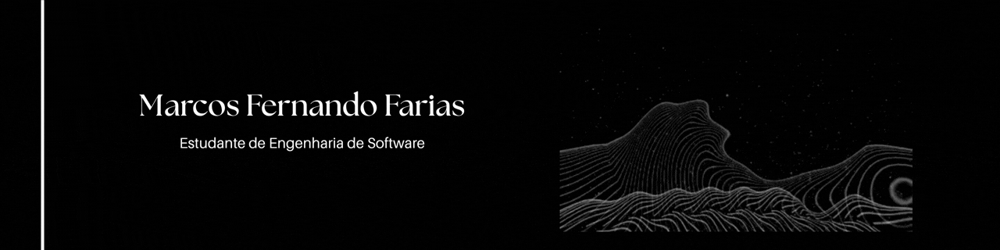

  

## Sobre mim

Olá, me chamo Marcos Fernando Farias, sou estudante de Engenharia de Software na UNINTER com foco em migrar para as áreas de back-end e front-end. Sempre tive curiosidade por tecnologia e constantemente aprofundo meus conhecimentos para me desenvolver como profissional.

  

## My Stacks

  
  
  
  
  
  
  

## Contato

  

 

<picture data-importer="pacman">
  <source media="(prefers-color-scheme: dark)" srcset="https://raw.githubusercontent.com/MarcosFarias7/MarcosFarias7/pacman-output/pacman-contribution-graph-dark.svg?game=pacman">
  <source media="(prefers-color-scheme: light)" srcset="https://raw.githubusercontent.com/MarcosFarias7/MarcosFarias7/pacman-output/pacman-contribution-graph.svg?game=pacman">
  
</picture>

<i>"Amor fati"</i> 

